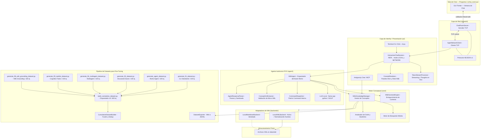
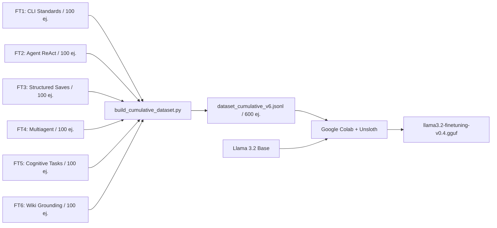

# Arquitectura del Sistema Wiki-Memory Agent



## Modos de Operación del Sistema

El sistema puede operar en dos modos de entrada, seleccionables en el arranque:

### Modo LOCAL (teclado — comportamiento original)
```
Usuario → Terminal → InteractiveChatSession → WikiAgent → LLM → Respuesta en terminal
```

### Modo RED (Sala de Chat GUI)
```
Usuario → GUI Tkinter → ChatRoomServer ──TCP NDJSON──► AgentNetworkClient
                                                              │
                                                    InteractiveChatSession
                                                              │
                                                          WikiAgent → LLM
                                                              │
                                         AgentNetworkClient ◄── Respuesta + Metadatos
                                                    │
                                             ChatRoomServer
                                                    │
                                            GUI (muestra respuesta)
```

---

## Componentes del Código

### Capa de Red (`src/wiki_agent/network/`)
- **`protocol.py`**: Protocolo NDJSON v1. Tipos de mensajes (`MessageType`, incluyendo `AGENT_LIST`), modelo `NetworkMessage` con Pydantic, versionado explícito, constante `HUMAN_SENDER = "HUMAN"` y funciones constructoras (`make_handshake`, `make_chat_message`, `make_agent_list`, `make_agent_status`).
- **`connection.py`**: `RobustSocketConnection` — búfer acumulativo de líneas para resolver la fragmentación TCP, `send_lock` para seguridad multi-hilo, cierre ordenado.
- **`server.py`**: `ChatRoomServer` — acepta conexiones simultáneas de múltiples agentes (`_connected_clients`), gestiona handshake con `client_name` y `client_id`, difunde la lista de presencia (`_broadcast_agent_list`) y despacha callbacks event-driven.
- **`client.py`**: `AgentNetworkClient` — conecta con la Sala de Chat, completa el handshake con su identidad persistente, almacena la lista de presencia de agentes y envía respuestas/estados tipados.

### Identidad Persistente del Agente (`src/wiki_agent/agent/identity.py`)
- **`AgentIdentityManager`**: Administra la persistencia en `data/agent_identity.json` (`agent_id` UUID, `agent_name`, `created_at`).
- Generación automática de nombres técnicos aleatorios únicos si no existe el archivo.
- Regla inmutable: Los nombres `HUMAN`, `HUMANO` y `USER` están reservados y estrictamente bloqueados para cualquier agente artificial.

### Sala de Chat GUI (`src/wiki_agent/chat_room.py`)
- Ventana Tkinter con tema oscuro (paleta Catppuccin Mocha).
- Historial de mensajes con etiquetas de color por tipo (usuario, IA, sistema, metadatos).
- Barra de estado en tiempo real (🧠 Pensando, 🔍 Buscando, 💾 Guardando…).
- Panel lateral con IPs disponibles, datos del agente e indicador de conexión verde/rojo.
- Sin dependencias externas — tkinter es estándar en todas las instalaciones de Python.

### Motor Conceptual
- **`src/wiki_agent/models.py`**: Modelos tipados con Pydantic (`WikiPage`, `PageMetadata`, `SearchResult`, `ConceptRelation`).
- **`src/wiki_agent/backends/`**:
  - `base.py`: Contrato `BaseWikiBackend`.
  - `local_xml.py`: Backend activo — Parser XML con Frontmatter YAML + extracción regex de `[[wikilinks]]` + backlinks + búsqueda insensible a acentos.
  - `local_markdown.py`: Backend heredado (no activo).
- **`src/wiki_agent/core/manager.py`**: Lógica de alto nivel para gestión de conceptos, resolución de rutas y búsquedas ponderadas.
- **`src/wiki_agent/core/assistant.py`**: `WikiAssistantEngine` — Inyección de contexto enriquecido.
- **`src/wiki_agent/core/health.py`**: Motor de salud del grafo (stubs, huérfanos, enlaces rotos).
- **`src/wiki_agent/core/indexer.py`**: Generador de índices y mapas conceptuales (MOC).

### Agente Autónomo POO (`src/wiki_agent/agent/`)
- **`loop.py`**: `WikiAgent` — Orquestador del bucle ReAct autónomo multi-ciclo (`MAX_CYCLES = 8`) con integración de lista de tareas y directivas de wiki-grounding.
- **`parser.py`**: `AgentResponseParser` — Extracción estructurada de `<thought>`, `<tasks>`, `<response>` y comandos válidos (`/search`, `/read`, `/save`, `/edit`, `/delete`, `/identify`, `/task_*`).
- **`task_list.py`**: `AgentTaskManager` y `TaskItem` — Modelado y seguimiento dinámico de tareas cognitivas paso a paso.
- **`identity.py`**: `AgentIdentityManager` — Identidad persistente del agente (`agent_id`, `agent_name`) y protección de la palabra clave `HUMAN`.
- **`xml_extractor.py`**: `ConceptXmlExtractor` — Validación rigurosa de micro-etiquetas XML y filtro de anuncios transitorios.
- **`commands.py`**: `AgentCommand` y `CommandDispatcher` — Patrón *Command* para `/search`, `/read`, `/save`, `/edit`, `/delete`, `/identify`, `/task_add`, `/task_done` y `/task_list`.
- **`src/wiki_agent/llm/`**:
  - `base.py`: Interfaz abstracta `LLMBackend`.
  - `llamacpp.py`: Proveedor activo — carga directa de GGUF con `llama-cpp-python` (`llama3.2-finetuning-v0.4.gguf`).
  - `ollama.py`: Proveedor alternativo.

### Capa de Interfaz y Presentación (`src/wiki_agent/ui/`)
- **`stream_processor.py`**: `TokenStreamProcessor` — Streaming en vivo de pensamientos en tenue y supresión en Deep Dive.
- **`renderer.py`**: `ConsoleRenderer` — Panel cian único, árbol conceptual, métricas de rendimiento.
- **`chat_session.py`**: `InteractiveChatSession` — Bucle REPL con soporte dual LOCAL/NETWORK, comandos interactivos (`/identify`, `/agents`, `/stats`) y arquitectura de cola de mensajes FIFO asíncrona (`queue.Queue` + worker thread) para admitir ráfagas de mensajes del usuario sin saturar la inferencia.
- **`src/wiki_agent/chat_room.py`**: Sala de Chat GUI (Tkinter) con caja de texto continua (sin bloqueo tras envío), feedback de cola de mensajes en tiempo real e indicador de estado del agente (`LISTO`, `PROCESANDO`, `ERROR`).
- **`src/wiki_agent/cli.py`**: Punto de entrada Click modular con comandos `chat`, `chat-room`, `mcp`, etc.
- **`src/wiki_agent/mcp_server.py`**: Servidor MCP con herramientas estándar para agentes IA.

---

## Flujo de Fine-Tuning


    COLAB --> GGUF[llama3.2-finetuning-*.gguf]
    AGENT[Agente Local]
    GGUF --> AGENT
```
