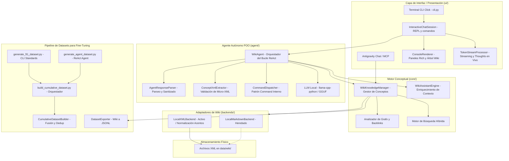
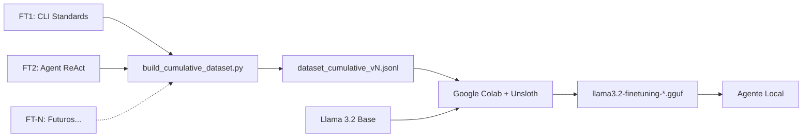

# Arquitectura del Sistema Wiki-Memory Agent

## Componentes del Código

### Motor Conceptual
- **`src/wiki_agent/models.py`**: Modelos tipados con Pydantic (`WikiPage`, `PageMetadata`, `SearchResult`, `ConceptRelation`).
- **`src/wiki_agent/backends/`**: 
  - `base.py`: Contrato `BaseWikiBackend`.
  - `local_xml.py`: Backend activo — Parser XML con Frontmatter YAML + extracción regex de `[[wikilinks]]` + backlinks.
  - `local_markdown.py`: Backend heredado (no activo).
- **`src/wiki_agent/core/manager.py`**: Lógica de alto nivel para gestión de conceptos, resolución de rutas y búsquedas ponderadas.
- **`src/wiki_agent/core/assistant.py`**: `WikiAssistantEngine` — Inyección de contexto enriquecido.
- **`src/wiki_agent/core/health.py`**: Motor de salud del grafo (stubs, huérfanos, enlaces rotos).
- **`src/wiki_agent/core/indexer.py`**: Generador de índices y mapas conceptuales (MOC).

### Agente Autónomo POO (`src/wiki_agent/agent/`)
- **`loop.py`**: `WikiAgent` — Orquestador del bucle ReAct autónomo multi-ciclo, recuperando contexto de memoria e interactuando con el LLM.
- **`parser.py`**: `AgentResponseParser` — Extracción estructurada de `<thought>`, `[PENSAMIENTO INTERNO]`, `<response>` y filtrado de comandos válidos con desduplicación y sanitizado de metatags.
- **`xml_extractor.py`**: `ConceptXmlExtractor` — Extracción y validación rigurosa de micro-etiquetas XML (`<definition>`, `<sections>`, `<relations>`) y filtro de anuncios transitorios ("Voy a...").
- **`commands.py`**: `AgentCommand` y `CommandDispatcher` — Implementación del patrón *Command* para la ejecución interna de `/search`, `/read`, `/save`, `/edit`, `/delete`.
- **`src/wiki_agent/llm/`**:
  - `base.py`: Interfaz abstracta `LLMBackend`.
  - `llamacpp.py`: Proveedor activo — carga directa de GGUF con `llama-cpp-python` (CPU o GPU).
  - `ollama.py`: Proveedor alternativo — requiere Ollama instalado.

### Capa de Interfaz y Presentación (`src/wiki_agent/ui/`)
- **`stream_processor.py`**: `TokenStreamProcessor` — Máquina de estados para streaming en vivo: visualización tenue de pensamientos (`🧠 Razonando...`) y supresión transparente de salidas intermedias en Deep Dive.
- **`renderer.py`**: `ConsoleRenderer` — Presentación Rich: panel cian único, árbol conceptual jerárquico consultado, tablas de ayuda y badges de métricas (`tok/s`, latencia, RAM).
- **`chat_session.py`**: `InteractiveChatSession` — Gestión del bucle interactivo REPL y despacho de comandos de terminal (`/stats`, `/tree`, `/save`, `/edit`, `/read`, `/delete`, `/clear`, `/exit`).
- **`src/wiki_agent/cli.py`**: Punto de entrada Click modular y delgado.
- **`src/wiki_agent/mcp_server.py`**: Servidor MCP con herramientas estándar para agentes IA.

## Flujo de Fine-Tuning

