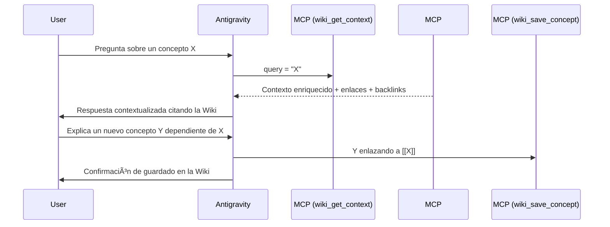

# Iteración 3: Integración de Antigravity como Asistente de Memoria Activa (MCP)

## 1. Objetivos de la Iteración
- Dotar a Antigravity de un canal directo y transparente para consultar y actualizar la Wiki en tiempo real mediante el protocolo MCP.
- Implementar un motor de **Contextualización Enriquecida** (`WikiAssistantEngine`) que inyecta no solo el texto del concepto, sino también su red de relaciones y backlinks.
- Establecer un protocolo de resolución activa de conceptos pendientes ("stubs").

## 2. Componentes Implementados
1. **`src/wiki_agent/core/assistant.py`**:
   - `WikiAssistantEngine.get_enriched_context(query)`: Genera un bloque Markdown formateado con el concepto principal, citas salientes expandidas y lista de backlinks.
   - `WikiAssistantEngine.resolve_stub(title, summary, category)`: Crea esqueletos documentados para conceptos pendientes.
2. **`mcp_config.json`**:
   - Configuración lista para conectar el servidor MCP en Antigravity u otros clientes MCP.
3. **`docs/ANTIGRAVITY_SYSTEM_PROMPT.md`**:
   - Reglas operativas que definen cuándo Antigravity debe leer, escribir y enlazar conceptos en la Wiki.
4. **Nuevas Herramientas MCP**:
   - `wiki_get_context(query)`
   - `wiki_resolve_stub(title, summary, category, tags)`

## 3. Flujo de Trabajo Demostrado
